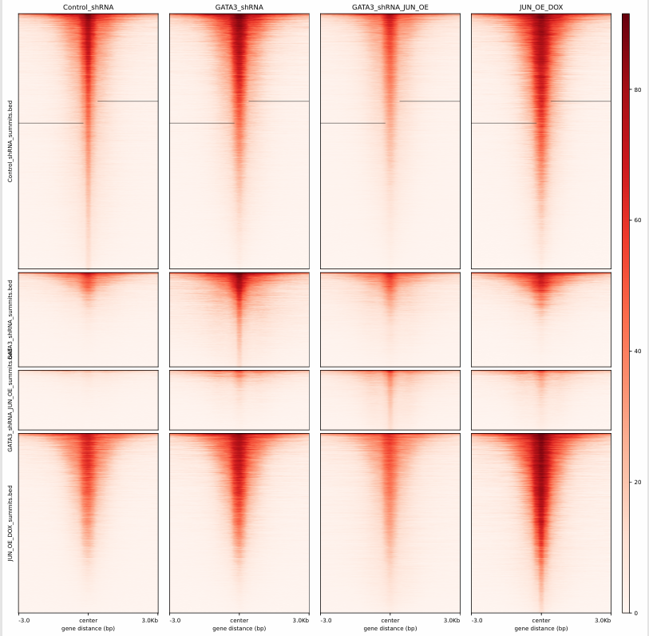
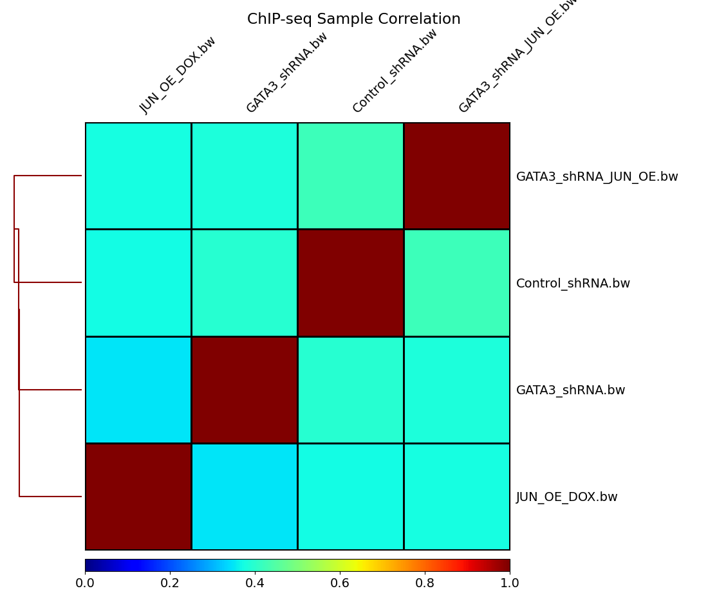
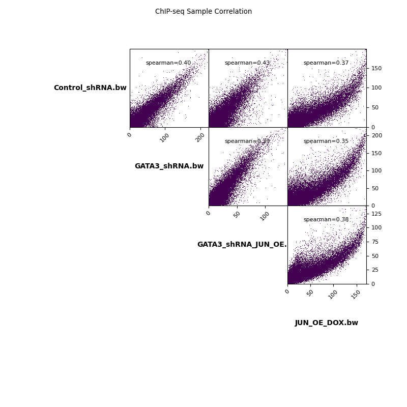
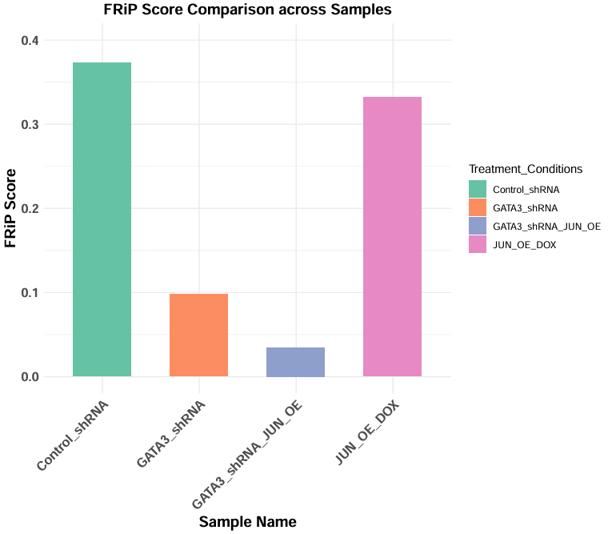

# ChIP-seq Analysis: Enhancer Reprogramming in MCF7 Breast Cancer

**The impact of GATA3 knockdown and JUN overexpression on H3K27ac enhancer activity**


---

## Overview

This repository contains a complete, reproducible ChIP-seq analysis pipeline built to study **enhancer reprogramming** in MCF7 breast cancer cells. Using publicly available **H3K27ac** ChIP-seq data (an active-enhancer histone mark), the project asks how two perturbations — **knockdown of the transcription factor GATA3** and **overexpression of JUN** — reshape the active enhancer landscape, both individually and in combination.

The analysis was completed as a project for the **Computational Genomics (GCD 8141)** course and runs end to end on an HPC cluster via SLURM, from raw FASTQ download through quality control, alignment, peak calling, quality metrics, and comparative visualization.

**Biological context.** Estrogen-receptor-positive (ER+) breast cancer is commonly treated with endocrine therapy such as tamoxifen, but resistance remains a major clinical hurdle. GATA3 is essential for normal mammary development and is linked to tamoxifen benefit, while the AP-1 factor JUN has been associated with restoring tamoxifen sensitivity. How these factors remodel the *epigenetic* (enhancer) landscape is less well understood — the question this project explores.

---

## Experimental design

H3K27ac ChIP-seq was analyzed across **four MCF7 conditions**:

| Condition | Description |
|---|---|
| `Control_shRNA` | Baseline MCF7 cells |
| `GATA3_shRNA` | GATA3 knockdown |
| `JUN_OE_DOX` | JUN overexpression (doxycycline-induced) |
| `GATA3_shRNA_JUN_OE_DOX` | Combined GATA3 knockdown + JUN overexpression |

### Objectives

1. Determine the impact of **GATA3 knockdown** on H3K27ac chromatin accessibility in MCF7 cells.
2. Analyze the impact of **JUN overexpression** on enhancer remodeling and transcriptional regulation.
3. Evaluate whether **combining** GATA3 knockdown and JUN overexpression produces a **synergistic** effect on enhancer reprogramming.

### Hypothesis

GATA3 knockdown reduces chromatin accessibility, JUN overexpression increases enhancer activity, and combining the two produces a synergistic effect on chromatin remodeling.

---

## Data

- **Reference paper:** Enhancer reprogramming driven by high-order assemblies of transcription factors promotes phenotypic plasticity and breast cancer endocrine resistance. *Nature Cell Biology* (2020). https://doi.org/10.1038/s41556-020-0514-z
- **GEO accession:** [GSE128460](https://www.ncbi.nlm.nih.gov/geo/query/acc.cgi?acc=GSE128460)
- **SRA BioProject:** [PRJNA527779](https://www.ncbi.nlm.nih.gov/Traces/study/?acc=PRJNA527779)
- **Reference genome:** GRCh38.p14 (hg38) from [GENCODE](https://www.gencodegenes.org/human/) (release 47 primary assembly)

The four SRA runs used in this project are: `SRR8742725`, `SRR8742726`, `SRR8742736`, `SRR8742716`.

---

## Pipeline

```
FASTQ (SRA)  ─►  FastQC / MultiQC  ─►  Chromap alignment (hg38)  ─►  BED ─► BAM (samtools)
                                                                          │
                                                                          ├─►  BigWig (deepTools)
                                                                          │
                                                   MACS2 peak calling  ◄───┘
                                                          │
                        ┌─────────────────────────────────┼─────────────────────────────────┐
                        ▼                                  ▼                                 ▼
                  FRiP score (QC)              bedtools peak overlap            deepTools correlation
                  + ggplot2 barplot            (unique / shared peaks)          heatmap + signal heatmap
```

**Alignment note.** This pipeline uses [**Chromap**](https://github.com/haowenz/chromap), which performs adapter/low-quality trimming and duplicate removal internally and outputs alignments directly in BED format — a fast, single-step alternative to the traditional trim → Bowtie2/BWA → dedup route.

---

## Tools and packages

| Tool | Purpose |
|---|---|
| [Miniconda](https://www.anaconda.com/docs/getting-started/miniconda/install) | Environment management |
| [SRA Toolkit](https://github.com/ncbi/sra-tools) | Download FASTQ from SRA |
| [FastQC](https://www.bioinformatics.babraham.ac.uk/projects/fastqc/) | Per-sample read QC |
| [MultiQC](https://github.com/MultiQC/MultiQC) | Aggregated QC report |
| [Chromap](https://github.com/haowenz/chromap) | Read alignment (ChIP preset) |
| [SAMtools](https://www.htslib.org/) | BAM conversion, sorting, indexing |
| [bedtools](https://bedtools.readthedocs.io/) | BED↔BAM, peak intersection |
| [MACS2](https://pypi.org/project/MACS2/) | Peak calling |
| [deepTools](https://deeptools.readthedocs.io/) | BigWig, correlation, heatmaps |
| R ([ggplot2](https://ggplot2.tidyverse.org/), [readxl](https://readxl.tidyverse.org/)) | FRiP score visualization |

---

## Repository structure

```
ChIP-seq-analysis/
├── code/
│   ├── genome_index.script.sh                   # Build the Chromap genome index
│   ├── chromap_alignment.script.sh              # Align FASTQ to hg38 with Chromap (ChIP preset)
│   ├── chrom_bed_to_bam_script.sh               # BED → sorted/indexed BAM → BigWig
│   ├── peakcalling.script.sh                    # MACS2 peak calling (treatments) + FRiP score
│   ├── control_peakcalling.sh                   # MACS2 peak calling (control) + FRiP score
│   ├── peak_overlap.sh                          # bedtools unique/shared peaks (Venn input)
│   ├── correlation_matrix-deeptools.script.sh   # Pairwise sample correlation (heatmap + scatterplot)
│   ├── heatmap-deeptools.script.sh              # H3K27ac signal heatmap over peak summits
│   ├── frip-score-visualization.R               # FRiP score barplot (ggplot2)
│   └── Project-2-RmarkdownRachana.Rmd           # R Markdown source of the full report
├── results/
│   ├── multiqc_report.html                      # Aggregated read QC
│   ├── *_peaks.narrowPeak                        # MACS2 peaks per condition
│   ├── *_summits.bed                             # MACS2 peak summits per condition
│   ├── peaks number details.png                 # Peak counts per condition
│   ├── venn diagram for unique and shared peaks.png   # Figure 1A
│   ├── FRiP_scores.png                          # FRiP score barplot
│   ├── Frip_scores.xlsx                         # FRiP scores (source data)
│   ├── heatmap.png                              # H3K27ac signal heatmap
│   ├── correlation_heatmap.png                  # Spearman correlation heatmap
│   ├── correlation_scatterplot.png              # Pairwise correlation scatterplots
│   ├── Project2-Report-Rachana.pdf              # Full written report
│   └── Project-2-Rachana-Combined.pdf           # Report + supporting figures
├── environment.yml                              # Conda environment specification
├── SRR_Acc_List.txt                             # SRA run accessions
├── .gitignore
├── LICENSE
└── README.md
```

---

## How to run

The steps below reflect how the analysis was run on an HPC cluster with SLURM. All heavy steps (`genome_index`, `chromap_alignment`, `peakcalling`, etc.) are provided as `sbatch` scripts in [`code/`](code/); lighter steps (FastQC on four files, MultiQC) can be run interactively.

### 0. Environment setup

The full toolchain is captured in [`environment.yml`](environment.yml), so the entire environment can be recreated in one step:

```bash
conda env create -f environment.yml
conda activate chipseq
```

On an HPC cluster, an interactive session can be started first (SLURM example):

```bash
srun --nodes=1 --ntasks-per-node=1 --mem=20g --time=4:00:00 -p agsmall --pty bash -i
```

### 1. Download data

The four run accessions are provided in [`SRR_Acc_List.txt`](SRR_Acc_List.txt).

```bash
module load sratoolkit/3.0.0
cat SRR_Acc_List.txt | xargs prefetch
cat SRR_Acc_List.txt | xargs fasterq-dump       # yields 4 FASTQ files
```

### 2. Quality control

```bash
module load fastqc/0.12.1
fastqc -o ../fastqc_output/ input_fastq/*.fq
multiqc . -o ../multiqc_output/
```

### 3. Build the reference index

```bash
# Download the GENCODE primary assembly
wget https://ftp.ebi.ac.uk/pub/databases/gencode/Gencode_human/release_47/GRCh38.primary_assembly.genome.fa.gz

# Index for Chromap (computationally intensive — submit as a job)
sbatch code/genome_index.script.sh
```

> Chromap requires its own index; indexes built for STAR, Bowtie2, or BWA are **not** interchangeable.

### 4. Alignment

```bash
sbatch code/chromap_alignment.script.sh
```

Core command (ChIP preset, MAPQ ≥ 20, minimum read length 15):

```bash
chromap --preset chip \
        -x "$indexDir/GRCh38_chromap_index" \
        -r "$ref" \
        -q 20 \
        --min-read-length 15 \
        -1 "$fastqDir/$f" \
        -o "$bamDir/$samp.chromap.bed"
```

### 5. Post-alignment processing

Convert Chromap BED output to sorted/indexed BAM and generate RPKM-normalized BigWig tracks:

```bash
sbatch code/chrom_bed_to_bam_script.sh
```

### 6. Peak calling

Peaks are called with MACS2 using `Control_shRNA` as the control for each treatment condition. The same script also computes the **FRiP score** (Fraction of Reads in Peaks) for each sample. A companion script calls peaks on the control sample itself (used as the reference point set for the signal heatmap):

```bash
sbatch code/peakcalling.script.sh        # treatment conditions vs. control + FRiP
sbatch code/control_peakcalling.sh       # control sample peaks + FRiP
```

Core MACS2 command:

```bash
macs2 callpeak \
    -t "$bamDir/${sample}.sorted.bam" \
    -c "$bamDir/Control_shRNA.sorted.bam" \
    -f BAM -g hs \
    --nomodel --shift -100 --extsize 200 \
    -n "$sample" --outdir "$peakDir"
```

### 7. FRiP score visualization

FRiP scores are collected into `Frip_scores.xlsx` and plotted as a barplot in R:

```bash
Rscript code/frip-score-visualization.R
```

### 8. Peak overlap (unique and shared peaks)

Shared and condition-unique peaks are identified with `bedtools intersect` on the MACS2 summit files for all four conditions, producing the pairwise, triple, all-four, and per-condition-unique peak sets that feed the Venn diagram (Figure 1A):

```bash
bash code/peak_overlap.sh
```

The script writes each intersection to a BED file and prints the peak counts. For example, peaks unique to one condition use `-v` (no overlap with any of the others):

```bash
# Peaks unique to GATA3_shRNA
bedtools intersect -a GATA3_shRNA_summits.bed \
    -b Control_shRNA_summits.bed GATA3_shRNA_JUN_OE_summits.bed JUN_OE_DOX_summits.bed -v
```

### 9. Correlation analysis and signal heatmap

```bash
sbatch code/correlation_matrix-deeptools.script.sh   # Spearman correlation heatmap + scatterplot
sbatch code/heatmap-deeptools.script.sh              # H3K27ac signal heatmap over peak summits
```

---

## Results

**Overall, 61,354 H3K27ac peaks** were detected across the four conditions, with only **61 peaks shared by all four** — a small common core of enhancers active regardless of perturbation.

### Peak overlap

Condition-unique peak counts show that the baseline (`Control_shRNA`) carries the largest set of unique enhancers, while the combined perturbation adds the fewest:

| Condition | Unique peaks |
|---|---|
| `Control_shRNA` | 26,626 |
| `JUN_OE_DOX` | 18,615 |
| `GATA3_shRNA` | 9,793 |
| `GATA3_shRNA_JUN_OE` | 6,187 |


*Figure 1A — Unique and shared H3K27ac peaks across the four MCF7 conditions (61,354 total; 61 shared by all four).*


### H3K27ac signal heatmap

Signal intensity over peak summits shows a clear **loss of H3K27ac when GATA3 is knocked down**, stronger signal with **JUN overexpression**, and a **mixed pattern** in the combined condition.



### Sample correlation

JUN overexpression is the most dissimilar condition genome-wide (lowest correlation with the others), consistent with JUN substantially reshaping the enhancer landscape. GATA3 knockdown stays more correlated with the control.




### FRiP scores (QC)

All samples exceed FRiP > 0.02, indicating reliable enrichment. Notably, `JUN_OE_DOX` has the **highest FRiP** despite having fewer total peaks — its H3K27ac signal is highly concentrated within its peaks — while GATA3 knockdown shows reduced FRiP.



---

## Conclusions

- **GATA3 knockdown reduces H3K27ac** (enhancer deactivation), supporting the hypothesis that GATA3 loss decreases chromatin accessibility.
- **JUN overexpression did not simply increase enhancer activity** as hypothesized — it reduced the total number of peaks, but concentrated signal (highest FRiP) at a distinct set of enhancers, pointing to enhancer *redistribution* rather than global activation.
- **No synergy** was observed in the combined condition. Instead, JUN appears to **partially compensate** for GATA3 loss at select enhancers, with the two factors acting through largely distinct enhancer programs rather than cooperatively.

---

## Future directions

- Integrate **RNA-seq** to link enhancer activity changes to downstream gene expression and affected pathways.
- Perform **motif enrichment** at GATA3- and JUN-dependent enhancers to dissect the regulatory logic.

---

## Author

**Rachana Pandey** — Ph.D. student, Translational Bioinformatics, University of Minnesota.

Project completed for GCD 8141 (Computational Genomics). The full written report, including figures and references, is available in [`results/Project2-Report-Rachana.pdf`](results/Project2-Report-Rachana.pdf).

## License

Released under the [MIT License](LICENSE).
